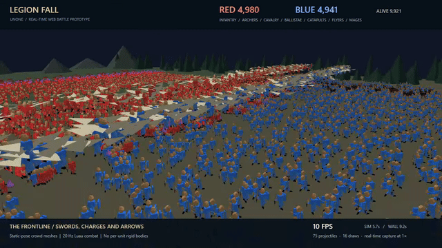

# Unone

Unone is an AI-native **3D game engine prototype with 2D workflows**: Rust owns engine mechanisms, while Luau owns game rules and content. The engine is still in early development; its long-term goal is complete only after seven game validations pass.

The current contract boundaries and host limitations are recorded in [Runtime contracts](docs/runtime-contracts.md). 3D transforms, cameras and presentation are an existing direction; mature 3D physics and a universal asset importer remain unfinished.

## 10,000-unit battle demonstration

[](docs/media/legion-fall-demo.mp4)

[Watch the full 54-second video](docs/media/legion-fall-demo.mp4) · [Run the demo](_Games/legion-fall/README.md) · [Measurements and limits](docs/legion-fall-demo.md)

Two armies, seven unit types, combat rules in Luau and instanced 3D meshes. This is a performance probe: the recorded 9,500+ living-unit segment runs at **9–10 FPS**, with simulation falling behind wall time. Static model poses; no per-unit rigid-body physics. The demo exposes work still needed rather than claiming a finished 10,000-unit performance target.

## Getting started from a clone

Everything below runs from the repository root. It does not need the private validation games. The public Legion Fall probe above is included under `_Games/legion-fall`.

Prerequisites:

- **Rust** — `rust-toolchain.toml` pins the channel and targets, so `rustup`
  installs the right one on first build. Nothing else to choose.
- **PowerShell** — most scripts here are `.ps1`. The one you need to get
  started also has a `.sh` version.
- **Python 3** — only for `python -m http.server`, to look at the Web hosts.
- **Emscripten** — only if you want the Web runtime. Point
  `UNONE_EMSDK_ROOT` at it; setup and the verified version are in
  [docs/platform-toolchain.md](docs/platform-toolchain.md). Skip it until you
  need a browser.

```powershell
git clone https://github.com/Ovan741852/Unone.git
cd Unone
cargo build -p unone-cli

# The official luau-analyze is a development-time tool and is deliberately not
# committed (decision 0005). Without it `verify`'s types gate fails, so fetch
# the pinned build once; the script checks the download against a recorded hash.
powershell -File scripts/install-luau-analyze.ps1
# not PowerShell? sh scripts/install-luau-analyze.sh  (Linux, macOS, Git Bash)

cargo test --workspace
```

Then make a game. The starter is five files and passes its own gates:

```powershell
# The engine refuses a project path containing '..', so resolve it first.
New-Item -ItemType Directory -Force ../my-game | Out-Null
$game = (Resolve-Path ../my-game).Path
cargo run -p unone-cli -- --project $game --json project init --name MyGame
cargo run -p unone-cli -- --project $game --json verify
```

`verify` should report four gates: `types`, `assets`, `tests` passing and
`layout` `not_applicable` (the starter draws no UI). That is the whole loop —
edit `scripts/main.luau`, add assertions to the tests, run `verify` again.

Keep the game outside this repository. `game api search ""` prints the complete
public API index; there is no separate list to find and no method names to guess.

Optional AI tools use the same protocol instead of adding engine-specific
dependencies. Discover and test them with `game plugin list`, `game plugin
inspect`, and `game plugin test`; see [docs/plugin-protocol.md](docs/plugin-protocol.md).
The bundled Blender bridge is optional and can validate/stage scene data without
Blender installed. A plugin is an external process, so the Rust runtime remains
deterministic and the AI can inspect its capabilities before using it.

## Workspace

Commands below run from your repository checkout. Use `--project <path>` to select a game; no drive letter or developer-specific directory layout is required. Legion Fall is included under `_Games/legion-fall`; older private validation games are not included.

- Engine roadmap: [docs/roadmap.md](docs/roadmap.md)
- Technical plan: [docs/ai-native-game-engine-plan-v0.1.md](docs/ai-native-game-engine-plan-v0.1.md)
- AI CLI workflow: [docs/ai-workflow.md](docs/ai-workflow.md)
- Stateful AI play/inspect/edit tools: [docs/developer-session.md](docs/developer-session.md)
- Current asset workflow contract: [docs/asset-workflow.md](docs/asset-workflow.md)
- Code review workflow: [docs/review-process.md](docs/review-process.md)
- Platform toolchain: [docs/platform-toolchain.md](docs/platform-toolchain.md)

## Current executable vertical slice

New games use the existing `game --project <new-or-empty-directory> --json project init --name <name>`.
It creates a five-file headless starter, including idle and Right-input tests, and returns
next-step argv that can be passed directly to a subprocess. Keep the game plan and engine
package outside the output directory; run git init only after init succeeds. Passing the
starter does not mean the game is complete; replace it with your own gameplay and tests.
The complete write, failure, and scene-input contracts are in the [AI development workflow](docs/ai-workflow.md).
When a search has no matches, use `game api search ""` to read the complete public index;
there is no need to find another api list or guess method names.

Run these from the engine workspace:

```powershell
cargo test --workspace
cargo clippy --workspace --all-targets -- -D warnings
$game = (Resolve-Path _Games/legion-fall).Path
cargo run -p unone-cli -- --project $game --json project inspect
cargo run -p unone-cli -- --project $game --json asset inspect --strict
cargo run -p unone-cli -- --project $game --json systems list
cargo run -p unone-cli -- --project $game --json api describe entity.setPosition
cargo run -p unone-cli -- --project $game --json run --frames 60
cargo run -p unone-cli -- --project $game --json test
cargo run -p unone-cli -- --json platform capabilities
```

Use verify as the aggregate author gate: it covers the typed check, strict asset
inspection, UI layout, and tests. The standalone asset inspect --strict command
above is for focused asset diagnosis or publication verification, not an
additional gate when verify is the selected entry point.
An AI host can also use the same Developer Protocol through a thin MCP stdio adapter:

```powershell
cargo build -p unone-cli
target/debug/game.exe --project _Games/legion-fall mcp
# Validate lifecycle, tool discovery, deterministic run, and semantic errors
.\scripts\mcp-smoke.ps1
```

MCP exists only in `unone-cli`; it is not an engine-core dependency. Tool results retain the complete `EngineResult` JSON and semantic diagnostics.

The current documented capability coverage includes Luau entrypoints, the `--!strict` contract, the official `luau-analyze` adapter, a headless fixed timestep, deterministic 2D rigid-body gravity/ground collision, Camera2D state, frame-by-frame input replay, the shared `tick_with_input` host boundary, seeded Luau random, seed/input observation digests, failed-reload fallback, scene Sprite size validation, a game-name-independent native wgpu preview, `preview --watch` script hot reload, JSON test manifests, bundle hash/cache/activation, asset-manifest/reference/active-generation queries, the host contract for resolving one asset from an active generation and reporting its verified sha256 (Rust and Web hosts share one archive format and error-code set), the `systems` contract for game-controlled engine-system selection, and the Spine/Effekseer semantic presentation layer (the engine transports animation selections and effect events; the host runs the runtime). `web/presentation/` has played the same slot-machine snapshot with spine-webgl and Effekseer for WebGL; native preview and the Android host still do not draw it.

For complete type checking, use `game check --types`. A formal engine package places a pinned official `luau-analyze` at `bin/luau-analyze.exe`, which the `bin/game.exe` beside it finds automatically. If the tool is missing, the engine reports an explicit error instead of describing the basic contract check as complete type checking.

## Open it and look

For the included 3D battle, follow [Legion Fall's build and run instructions](_Games/legion-fall/README.md). They export a self-contained player and serve its output directory. The older `web/presentation/` and `web/runner/` validation hosts require their own game resources; cloning this repository alone does not provide those private games.

## Current Web status

`unone-engine` has passed a library compile with `wasm32-unknown-emscripten` and an Emscripten wrapper. `unone-web-smoke` has also completed linking, run 60 frames under host Node (requiring `--experimental-wasm-exnref`), and been loaded by `web/smoke/index.html` in a browser. `web/host/` covers the snapshot bridge; `web/live/` additionally covers browser animation frames, host-provided project payloads, script reload, pointer-driven execution of the same Rust/Luau runtime, and the diagnostic raw WebGPU adapter. `web/runner/` uses the abstract renderer contract with a bundled Three.js adapter (WebGPU when available, WebGL fallback), uploads declared SVG/PNG/JPG/WebP sprites as GPU textures, and can read engine-produced content archives. This is still not complete production asset packaging; OPFS/chunked asset streaming, CDN policy, and formal error transport remain unfinished.

Android preflight has passed an engine and minimal `unone-mobile-ffi` adapter cross-compile for `aarch64-linux-android` and `x86_64-linux-android` using NDK `27.1.12297006`; this is not APK, emulator/device, or mobile-lifecycle evidence. See [docs/mobile-host-abi.md](docs/mobile-host-abi.md) for the ABI description. Mobile validation is a separate deferred track and is not a prerequisite for the Web slice; Android/iOS host and lifecycle evidence will be added when those hosts are explicitly exercised.

## Boundaries

The engine provides only necessary game mechanisms. Game rules, numbers, ViewModels, UI flow, content catalogs, download timing, and operational services stay in the game project or service layer. UI follows MVVM; ECS + systems handle high-frequency simulation.

The first Bundle version contains only a manifest, dependencies, host-provided fetch, streaming hash verification, content-addressed cache, staging, and generation activation. It does not include CDN, P2P, differential updates, or remote script execution. Fetch, retry, and platform-storage policy stay out of engine core.

## Validation games

The included Legion Fall probe stresses 3D crowds and Luau combat. Separate validation projects cover physics, cameras, input replay, scene/prefab, assets, UI, hot reload, headless tests, and AI authoring. Long-term acceptance still includes 3D Racing, Red Alert-style RTS, Dota-style Idle Battle, AVG Romance, Auto Chess, Slot Machine, and Fish Machine.

The broader acceptance matrix belongs to the separate validation suite and is not included here. If you have that suite, pass the path to its `acceptance-matrix.json` explicitly to `scripts/validate-game-matrix.ps1`; incomplete gates return a non-zero status.

Release player/export: [build and measurements](docs/player-export.md).
Native 3D particle JSON, API and preview: [particle v1](docs/native-particles.md).
Reference-game capability probe: [_Games/dragon-tycoon3](_Games/dragon-tycoon3/README.md).

AI-directed optimization: [measured results](docs/legion-fall-optimization.md), [profiling API](docs/profiling.md), [instance memory transport](docs/instance-memory-transport.md).
Game-owned WASM extensions: [proposed ABI and AI implementation contract](docs/proposals/wasm-compute-v1.md) (design only; no module loader yet).
