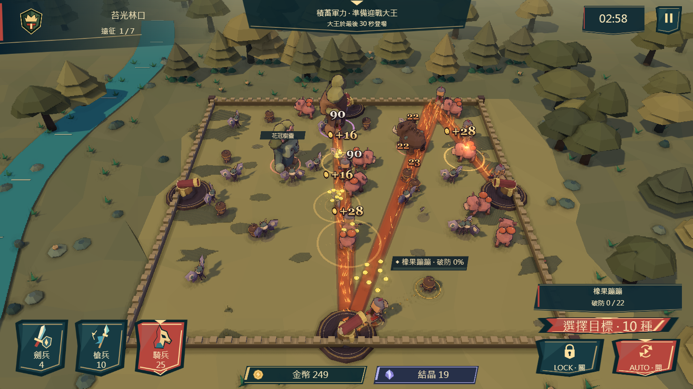
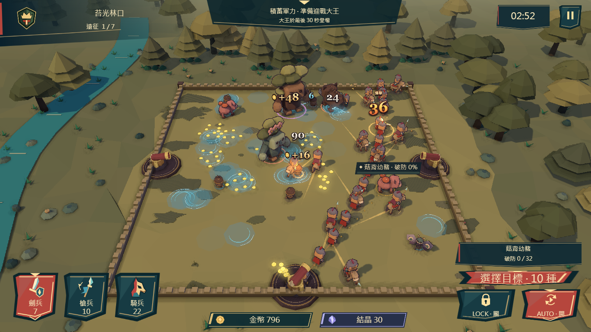

# 火路、黑油與水雷：橫版實作版

這版參考《神界：原罪 2》的「地表能被另一種元素改變」思路。Larian 官方文件列出油／毒可點燃、水／血可帶電；本遊戲先實作油＋火、水＋雷兩條連鎖，不宣稱已包含原作全部地表規則。[Larian：TransformSurface](https://docs.larian.game/Osiris/API/TransformSurface)

玩法在 `gameplay/element-runtime.luau` 與 `gameplay/skill-runtime.luau`，由 `tools/build-skills.mjs` 打包進正式 Luau。沒有把技能、傷害或選敵加進 Rust。`presentation/element-fx.mjs` 只讀實際地表、附著狀態與反應事件。

## 三種可組合觸發條件

|觸發|本版案例|行為約束|
|---|---|---|
|移動指定距離 `distance`|燎原步：每走 1 單位鋪火|每條規則各有距離餘數與路徑；高速可一次跨越多個門檻，反彈保留轉角，空中不計。|
|造成傷害瞬間 `damage`|黑油、喚雨、掌心雷|使用真實已造成傷害的事件，同一模擬步進內处理；預設只聽主要傷害，避免次級傷害自我觸發。|
|死亡瞬間 `death`|油甕遺贈|接觸死亡、壽命到期有效；每兵一次。召回、返回城鎮、退款、結算不算死亡。|

規則包含 `id / modifier / trigger / action`，以及該行為需要的距離、半徑、持續時間、數量上限。順序明確為：命中先抹油／灑水，再觸發掌心雷，最後解析元素反應；兩份不同距離的規則不共用計步器。新增觸發組合可沿用規則；新的 action 仍需 Luau 實作與驗證，不是執行任意外部文字。

## 五件技能裝備

B 指派兵時已套用裝備、科技等基礎增傷的傷害快照。表中的加價是標準加價，整筆派兵報價仍按目前設定乘 0.5、向上取整。

|技能／裝備|部位、購買價|效果|標準派兵加價|
|---|---|---|---|
|燎原步／燎原戰靴|腳，14 結晶|每走 1 單位留下火路，持續 3 秒，半寬 0.48。經過的怪物灼燒 2 秒，每 0.6 秒造成 12% B。|+4|
|滑溜黑油／黑油刃|武器，11 結晶|主要命中沾油 3 秒，移速 −25%；遇火消耗油，爆燃并強化灼燒。|+3|
|喚雨擊／喚雨手環|手，12 結晶|主要命中使目標潮濕 3 秒，留下半徑 1.2、持續 3 秒的水池。|+3|
|掌心雷／雷核冠|頭，16 結晶|主要命中追加 20% B 雷傷；潮濕或水池可發生水雷反應。|+5|
|油甕遺贈／油甕背甲|身，11 結晶|真正死亡時留半徑 2.2、持續 4 秒的油池；經過沾油减速，碰火可燃燒。|+3|

全數可由裝備、科技與最高階附魔取得；有 SVG 圖示、Blender 源檔、GLB 模組、貼圖。共 53 技能／裝備、13 個流派。

- **焦土油獵**：燎原步＋滑溜黑油＋油甕遺贈；第 4 頁流派採購。
- **雨幕雷網**：喚雨擊＋掌心雷＋穿透；第 5 頁流派採購。可以同兵裝水雷，也可以先派喚雨兵鋪場、再換掌心雷兵引爆。

## 兩條連鎖

**黑油＋火**：油怪碰到火路、火焰斗篷、鳳凰火焰，或既有火屬性命中／餘燼爆炸，就消耗黑油，立即造成 25% B 爆燃伤害，並施加 2.4 秒強化灼燒，每 0.6 秒 24% B。每怪的爆燃冷卻 1 秒，新油才能再次反應。場上的油池即使沒有怪物站著，與火路接觸也能變成 3 秒火地表；相連油池會接續燃燒。

**潮濕＋雷**：消耗潮濕，立即造成 25% B 感電反應，並感電 1.8 秒、每 0.6 秒 12% B，移速 −35%。從起始怪物依距離／ID 順序向 3 單位內的潮濕怪物傳導，同一條連鎖最多 4 隻，含起始目標；每怪反應冷卻 1.2 秒。已有反應冷卻的怪物不再重複吃同一波傷害。

雷擊也會讓命中處相連水池帶電 1.8 秒；水池總存在時間重設為 3 秒，電力消退後恢復普通水面。帶電水面可對進入的合格目標觸發感電，所以地表仍有範圍壓制作用；「四隻」是單條傳導的上限，不是整片水池永遠只能傷四隻。水面不會自行反覆充電延命。

## 共用規則與歸屬

- 所有傷害沿用破防／開獎流程，破防仍可能落空；沒有繞過規則扣一般 HP、保證出獎或改變中獎機率。
- 爆燃、傳導、感電跳傷是次級傷害，不爆擊、不再次觸發黑油／喚雨／掌心雷。火與雷仍可啟動其明確允許的元素反應。
- 火路灼燒、鳳凰灼燒、爆燃灼燒共用一個 burn 狀態；中毒、灼燒、感電各自不疊層。刷新不重置下一次扣血時間，較強劑量保留數值與玩家歸屬。
- 減速取冰緩、油、感電三者中最強的一個，不相乘；油與潮濕不是冰緩，既有碎冰仍讀取冰緩狀態。
- 原始油／水可以由另一玩家引燃或通電。轉換後伤害與收益使用引發反應者的部隊、付款快照及玩家歸屬；原始地表創建者仍負責其數量上限。已有更強持續傷害時仍遵守前述最強劑量規則。
- LOCK 同時限制直接反應、傳導目標與轉換後地表伤害；AUTO 可正常造成範圍效果。
- 火路每兵最多 12 段：同方向連續段合併到最多 4 單位，延續時刷新這段壽命，轉彎不跨接。水池每兵最多 6 片，超過替換最早的；油甕每兵只生成一次。
- 士兵死亡後已留下的地表和持續伤害能繼續，不能復活原兵；暫停凍結所有時鐘；回合結束立刻清除地表、附著、待處理事件，演出期間不再傷害或發獎。
- 本版沒有新增水滅火、水結冰、毒雲爆炸等其他轉換。這些可沿用相同分層之後加入。

## 演出與密度

火路採焦痕、斷續火舌與少量火星；油池用深紫黑與細反光，水池偏青藍，帶電時產生鋸齒電弧。灼燒跳傷暖橘，雷傷青藍，沿用原有傷害／爆擊／金幣層級。「未開獎」仍只顯示目前目標，最多一條。

使用既有兩批固定 GPU 緩衝；細節事件最多 36 個，毒霧與元素地表合計最多 400 個地面標記，火舌等細節按密度降級。這是渲染預算，沒有把漏畫的傷害停掉。遊戲層用局部空間分桶查詢地表接觸；反應保持固定順序，渲染不改 RNG 或命中。

## 驗證

- `tools/verify-elements.mjs`：55 項實際 Unone WASM 檢查，含兩種獨立距離門檻、反彈路徑、死亡一次、召回排除、油點燃、水傳導上限、玩家歸屬、LOCK、有限壽命、非遞迴傷害。兩個流派各跑 900 個正式更新步進，每步核對金幣、部隊及場地範圍。
- `tools/verify-element-browser.cjs`：橫版正式流派第 5 頁、指定採購、53 件模型載入；火油配裝與先水後雷的實際戰鬥截圖；暫停、關閉 Bloom、高密度緩衝上限、結算清理。
- 截圖配裝由瀏覽器內測試注入，沒有修改正式開局送裝備；場上移動、傷害、反應與開獎均執行正式 Luau。凍結事件資料只用在渲染緩衝測試。
- 首版數值完成短程功能快測，尚未代表完整 20 分鐘經濟平衡、多玩家真人測試或全裝置幀率保證。

