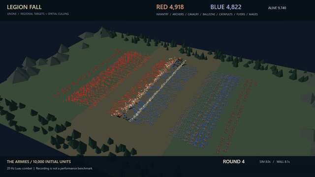
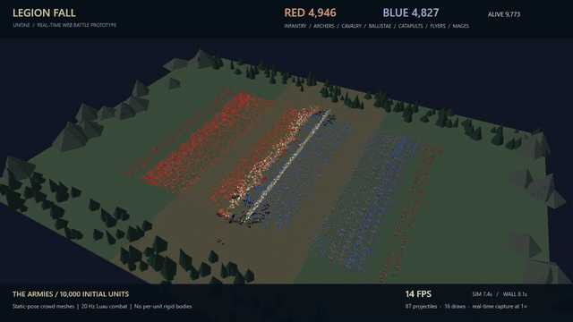

# LEGION FALL — 10,000-unit battle probe

A Web battle prototype used to expose engine limits. Two armies start with 5,000 units each and fight automatically: infantry, archers, cavalry, ballistae, catapults, flyers and mages. The game includes melee, ranged trajectories, area damage, flying movement, deaths and selectable cameras.

**第四輪：區域共享尋敵與空間裁切**



實際錄影、原速播放、GIF 10 fps；正常戰鬥會減員，不是效能 A/B。[錄製資訊](../../docs/media/legion-fall-round4.md) · [第四輪報告](../../docs/legion-fall-round4.md)。

| 優化前（基準版本） | 第一輪優化後 | 第二輪優化後 |
|---|---|---|
|  |  |  |

[第二輪：削減長幀，仍未穩定 60 FPS](../../docs/legion-fall-round2.md)。These are different recording windows, not a controlled FPS A/B test.

Optimized build, 12 seconds at original playback speed, GIF encoded at 10 fps. [Capture details](../../docs/media/legion-fall-optimized.md) · [Optimization report](../../docs/legion-fall-optimization.md).

The [original 54-second baseline recording](../../docs/media/legion-fall-demo.mp4) predates optimization. Neither recording proves stable 60 FPS with 10,000 units.

## Run

From the repository root, after installing the documented Web toolchain:

```powershell
cargo build -p unone-cli
powershell -File scripts/build-web-live.ps1 -Player -Development -Project _Games/legion-fall
node _Games/legion-fall/export.mjs
python scripts/serve-player.py _Games/legion-fall/dist/web --port 8190
```

Open `http://127.0.0.1:8190/`. Choose 1,000 / 5,000 / 10,000 units, reset, pause, or change the camera. The developer panel exposes the same registered Luau controls to humans and AI. The optional stress control prevents deaths; it is disabled in the recording.

For recording, use `python _Games/legion-fall/serve_capture.py _Games/legion-fall/dist/web --output artifacts/legion-capture --port 8195`, open `http://127.0.0.1:8195/?capture=1`, then click the recording button. Keep that tab visible throughout capture. The loopback server accepts only the three fixed recording filenames.

## Boundaries and validation

- Combat rules, target selection, movement, projectiles, damage resolution and cameras live in `main.luau`. Combat updates at 20 Hz; the engine ticks at 60 Hz.
- Units are Luau records rendered through packed GPU instances, not 10,000 entity objects or rigid bodies. This project disables both physics systems. It does not benchmark 10,000-body physics.
- Meshes use static poses. There is no skeletal crowd animation, obstacle navigation or production-quality battle balance. Bounded target queries and per-team projectile limits trade fidelity for cost.
- Web instancing is the demonstrated renderer. Native visual parity for this crowd is not implemented; this recording does not validate Android performance.
- `battle.test.json` runs 600 frames and checks that combat produces losses while conserving initial unit count. The actual exported host payload also passes CLI/WASM final observation-digest comparison for that replay. Neither check proves visual parity or general cross-platform determinism.

Performance findings and capture conditions are in [the measurement record](../../docs/legion-fall-demo.md). Asset authors, licenses and conversion details are in [ASSETS.md](ASSETS.md).

The original baseline recording predates the optimization. See [the optimization report](../../docs/legion-fall-optimization.md) for controlled CPU measurements; these are not a replacement browser FPS recording.

## Round two work scheduling

Combat still commits at 20 Hz. Each update is now prepared in three fixed Lua work partitions over the 60 Hz engine clock; the third tick resolves damage and publishes the complete state. Unit iteration and damage ordering are unchanged. There is no wall-clock budget in gameplay. The camera reads the last published battle time. Reset discards pending work; the game pause control freezes and resumes its current phase.

Run `node _Games/legion-fall/verify-phases.mjs <development-export>` to verify no partial publication and reset/pause behavior at both unfinished phases. This test normalizes only engine frame/time when comparing a reset to a fresh game. For the full battle, compare every tick with the previous export using `scripts/compare-player.mjs --checkpoint-every 1`.

[第三輪：精確 hash 重用與工具量測](../../docs/legion-fall-round3.md)。目前工作分配為 37/53/10，遊戲規則維持 Lua。

[第四輪報告](../../docs/legion-fall-round4.md)：Lua 改用區域共享目標，工作分配 40/60/0；Web instance 空間裁切預設啟用。這輪會改變目標選擇，不能與舊版戰鬥 digest 當成同一個 replay。

## Web Worker 與 BlueStacks

[真正 Worker 的對照報告](../../docs/legion-fall-worker.md) · [20 秒 BlueStacks 實錄](../../docs/media/legion-fall-worker-bluestacks.mp4)。整個 Lua 模擬移到 Worker；這是實驗 player，尚未取代一般 export 的正式 host。
