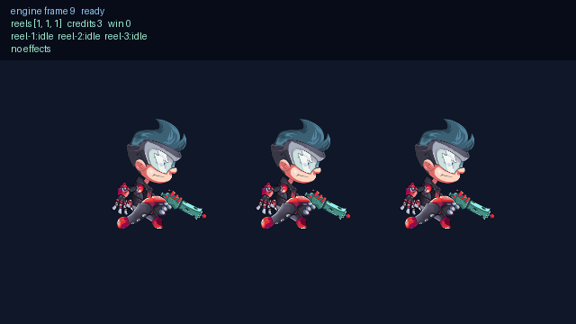

# Presentation host: Spine and Effekseer actually playing

日期：2026-09-05

## 目的

Decision 0028 只做到語意層：引擎保存「要播哪個動畫片段」與「目前有哪些特效實例」，但沒有任何 host 會畫。這一輪把兩個真實 runtime 接上，用老虎機驗證專案證明同一份 snapshot 可以被實際播放，並錄下結果。

## 實作

- `EngineRuntime::load_source_with_systems`：記憶體載入的 host 入口現在接收專案的 `systems` 宣告。先前 Web/mobile 一律使用引擎預設，因此 `spine`／`effekseer` 永遠是關的。
- `unone-web-live-smoke` 的 `HostProject` 新增 `systems`，與 `project.unone.json` 同一份宣告。
- 新增 `web/presentation/`：載入專案 config／script／scene／asset manifest，餵給 wasm 引擎，每 frame 讀 snapshot 後
  - 以 `world.entities[].animation` 驅動 spine-webgl，`started_frame` 改變才切片段；
  - 以 `world.effects` 的 handle 一對一鏡射 Effekseer 實例。
- vendored runtime 放在 `web/vendor/`：spine-webgl 4.2.120、Effekseer for WebGL 1.60e。
- 老虎機專案改用真實資產：Spine 官方 `spineboy` 範例（skeleton + atlas + texture，以 `files` 宣告附屬來源）與 Effekseer 官方 `Simple_Ring_Shape1` 特效；先前的 placeholder 檔已移除。
- 新增 `scripts/record-presentation.py` 與 `window.unoneHost.record(...)`：由頁面自己推進固定格數、把每格 PNG POST 給錄影器，再組成 GIF，並把該格的引擎狀態疊在畫面上。

## 驗證



```text
cargo clippy --workspace --all-targets -- -D warnings   PASS
cargo test --workspace                                  PASS
scripts/build-web-live.ps1                              PASS
slot-machine: check --types / test / asset inspect --strict / bundle pack  PASS
```

錄影是 230 個引擎 frame、每 2 格取樣的 115 格。畫面左上角是同一格的引擎狀態：轉動時三軸都是 `run`，依序在各自的停止 frame 切回 `idle`；`reels [4,2,4]` 成對中獎時 `effect-1` 出現，光環同時播放。畫面與狀態同源，沒有另一套表現邏輯。

## 已知限制

- 只有 Web 這一個 host 會播。native preview 與 Android host 仍不畫 Spine 或 Effekseer。
- 錄影用的瀏覽器分頁是隱藏的，`requestAnimationFrame` 不會觸發、`setTimeout` 被節流到約 1 Hz，所以 host 迴圈與錄影都改為自行推進。互動播放在正常可見分頁才會是即時的。
- **Spine 不是自由軟體**：Spine Runtimes License 要求每位整合者持有有效的 Spine 授權，`spineboy` 範例資產同樣受限。Effekseer 是 MIT。細節與後果見 `web/vendor/README.md`。
- 特效的「站起來面向鏡頭」旋轉是 host 慣例（範例特效畫在地面），不是引擎狀態。
- 動畫事件與播完通知仍沒有契約。

## 下一步

native preview 與 Android host 尚未消費 `animation`／`effects`；在決定是否為它們引入 Spine/Effekseer runtime 之前，應先確認 Spine 授權，或改用不受此限制的骨骼格式。
