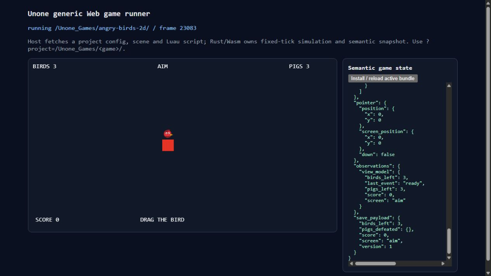

# 2026-09-06：共用 observation digest 整合驗收

使用者同意「抽出」。兩位製作子代理均為 Luna / max；主代理做契約審查、
整合測試與本地提交。直接在 master，沒有新分支、worktree 或 push。

## 交付與限制

- Core 唯一公開入口 `unone_engine::observation_digest(&WorldSnapshot)`，
  回傳 `Result<String, serde_json::Error>`；CLI run 與 Web 共用。
- 保留 typed snapshot 的 `serde_json::to_vec` + 小寫 `sha256:` 定義；
  不重新排序為 JSON Value、不在 JS 複製 hash、不呼叫 run/tick 或改 seed。
  有真正 serialization error 時明確失敗，不 hash 空 buffer。
- Web envelope 和 digest 消費同一 snapshot；runner 顯示完整 observations。
- 2D core/API 同輪加入 rotation、scale、sprite layer；顯示 scale 與旋轉不改
  碰撞體。新欄位自然使完整 digest 改變，這不是 hash 演算法改變。
- Host rotation/layer 繪製、重新發行 immutable package、獨立盲測尚未完成。
  七款遊戲 final gate 和總驗收不變。

## 主代理實跑

| 檢查 | 結果與範圍 |
|---|---|
| `cargo test --workspace` | 100 passed：engine 82、CLI 6、mobile FFI 8、Web ABI 4 |
| `./scripts/build-web-live.ps1` | 成功重建 Emscripten wasm/JS |
| `node web/runner/semantic-output.test.mjs` | PASS，無 GPU 的純語意輸出回歸，不冒充無 GPU 真瀏覽器測試 |
| `game api describe entity.setTransform2D` | 新 API 可發現，回傳 visual-only / collider-independent 語意 |
| `game verify --project D:/Projects/Unone_Games/angry-birds-2d --json` | 6 gates passed，含三個 UI 畫面與 6 個 deterministic cases；仍非 host parity gate |
| 本地 in-app browser + 新 wasm | source-mode AngryBirds2D 的 observations.view_model、frame、digest 皆可讀；两次 frame 增加且 digest 不同 |

ABI 回歸比較 Web digest 和 CLI 使用的 public run report；這是 native ABI
路徑比較，不是同輸入完整 wasm/native replay parity。瀏覽器實跑證明 wasm
輸出可見及持續更新，沒有藉此宣稱 roadmap #13 已完成。

## 審查回饋

主代理要求修正 getTransform2D descriptor 的時機描述，改為呼叫當下；
碰撞獨立回歸補成逐 frame 比較 position/velocity/contact/ground contact，
並確定 fixture 真正發生 entity 與 ground contact。這些修正已測試通過。

測試設計時曾以 math.huge 嘗試誘發 serde_json error；serde_json 會把非有限
float 寫成 null，該測試前提不成立，已移除。沒有為了測試而改 hash 定義或
宣稱新 helper 提供非有限浮點驗證。

Claude CLI #29 因 session limit 失敗。使用者已批准先本地提交、之後補 review，
見 `docs/issues/2026-09-06-claude-cli-review-29.md`。

真實瀏覽器同時找到既有 DOM sprite 中心偏移，已立即提問並記錄於
`docs/issues/2026-09-06-web-sprite-center-offset.md`。不以改遊戲座標掩蓋 host 問題。

## 畫面與可追溯證據

依 computer-use 技能使用瀏覽器操作、DOM 讀取與原始截圖，未合成或修圖。
`docs/evidence/2026-09-06-web-semantic/observed-state-pair.json` 保存兩次實讀的
完整 runner output；不是完整 Rust WorldSnapshot，也不能用它重算 canonical digest。

另一張 `runner-digest-and-offset.png` 同時保留 digest 區段和已發現的貼圖偏移。
畫面來自既有遊戲 source-mode，並非 package-only 子代理盲測；後者尚未派工。
