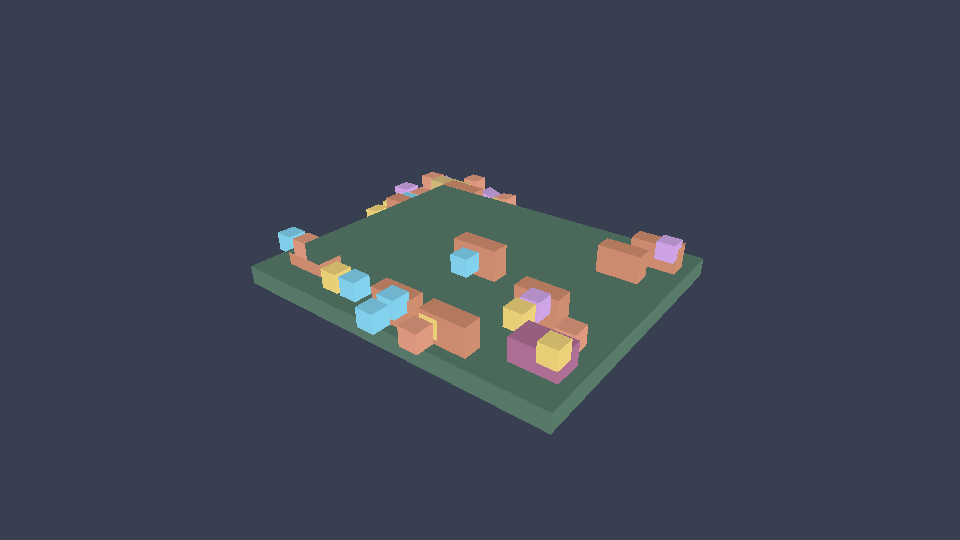

# Native Renderer Visual Review: Wuxia Sandbox

Status: request Unone renderer confirmation
Date: 2026-09-19
Project: `_Games/wuxia-sandbox`

## Evidence

The screenshot was captured through the native tools API while the simulation was paused, so it is a direct renderer readback rather than a desktop/computer-use screenshot.

- Frame: `5102`
- Size: `960x540`
- Source: `native_renderer`
- Scope: `game_viewport`
- Observation digest: `sha256:63f237d0508a862bdc8de02cf3f380727292083800810dda7523a15e11a6f5e4`
- Screenshot metadata: `includes_ui: false`
- Runtime UI tree at the same paused inspection: `21` nodes

## What looks wrong

1. The world occupies only a small central part of the canvas and is surrounded by a large empty background. The camera needs a deliberate fit/framing policy for this town, not a fixed debug composition.
2. Buildings and residents are rendered as color-coded cuboids/silhouettes. The renderer does not visibly consume the mesh geometry, UVs, materials, or the newly selected `building.mesh.json` asset.
3. The screenshot has no names, avatars, intent bubbles, path lines, status panel, event feed, or controls even though the Luau UI tree publishes them.
4. The visual language cannot distinguish a market, clinic, training yard, monster den, or resident role. Color-by-entity-ID is debug coloring, not game presentation.
5. There is no lighting/shadow/material depth cue that would make the scene read as a town. The result looks like a renderer smoke test rather than a playable game view.

## Root cause to confirm

The current `unone-cli` preview uses its own deterministic mesh-silhouette path in `crates/unone-cli/src/main.rs`. The native screenshot endpoint calls that same path and explicitly returns `includes_ui:false`. `unone-native-player` is a separate renderer target, so a successful asset decode and a native screenshot do not currently prove player presentation parity.

Please confirm whether this is an intentional “debug silhouette preview” boundary or an unfinished production preview. The current product behavior is ambiguous: the command is called `preview`, but its screenshot cannot show the game UI or the declared mesh presentation.

## Requested Unone decision and acceptance

- State the capability contract for `game preview`: debug silhouette only, or playable native presentation.
- If it is playable presentation, route it through the same native renderer/material path as the player, or document why two renderers are required.
- Render the semantic UI tree in the native preview and screenshot path. Return `includes_ui:true` only when it is actually drawn; otherwise keep the false capability explicit.
- Consume mesh geometry, UVs, texture bindings, and material data for `mesh3d`; this must include the current `building.mesh.json` fixture and later GLB/glTF imports.
- Add camera fit/framing, depth ordering, lighting/shadows, and a minimum scale rule so 40 residents remain readable.
- Add a visual acceptance fixture requiring at least: differentiated buildings, resident identity marker, visible intent/path indicator, and a selectable detail panel.

## Game-side boundary

The Wuxia Sandbox already owns the correct Luau semantics: grid movement, non-overlap reservations, names, roles, relationships, motives, events, and the 21-node UI tree. It should not hard-code renderer-specific cubes or duplicate a native UI renderer to compensate for this host gap.
