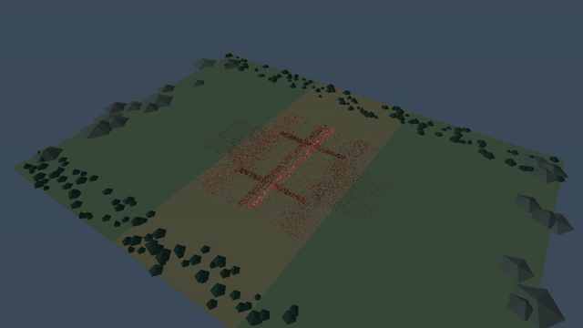
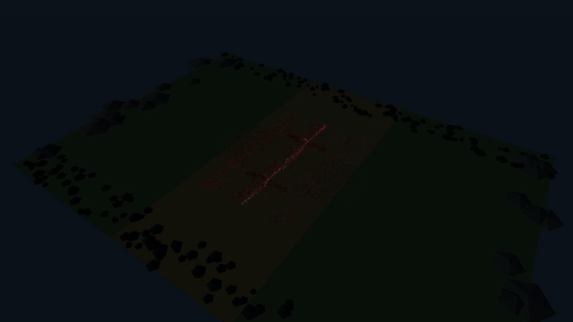
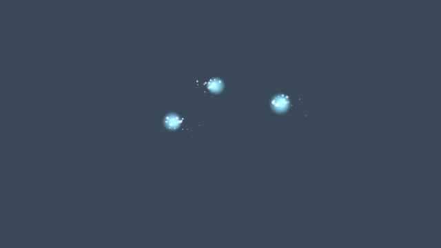

# Native battle: tested capacity, 2026-09-09

Windows 在本機 RTX 5080 上，**6 萬人達到 p95 < 16.67 ms**；7 萬人平均 113–115 FPS，但 p95 18–20 ms，不能宣稱每幀穩定 60 FPS。Android **BlueStacks** 的 5 萬人平均 59.47–60.00 FPS，p95 21–22 ms；這是接近 60 FPS 的模擬器結果，尚未證明手機可達相同表現。

測試僅涵蓋 Windows 與 Android 原生 renderer，沒有 WebView。不是全平台、任意遊戲或任意裝置的引擎上限。Windows 8 萬人開始丟 tick；Android 6 萬人的平均 FPS 低於 59。沒有用放慢模擬、凍結戰鬥或錄影加速來通過測試。

## 實測

每次 30 秒測速，seed 42，預跑 300 個 runtime ticks，60 次 presentation 暖機；錄影關閉。固定 60 Hz runtime，Luau 戰鬥以 20 Hz 分段更新，壓力模式保留所有士兵，七種兵種、投射物和有預算上限的特效持續運作。每名士兵沒有剛體或骨骼動畫。

| 平台 | 存活士兵 | 末幀視錐內士兵 | 末幀全部 mesh 三角面 | 平均 FPS | p95 ms | 模擬 Hz | 丟 tick | 證據 |
|---|---:|---:|---:|---:|---:|---:|---:|---|
| Android / BlueStacks GL | 40,000 | 40,000 | 548,894 | 59.98 | 20.84 | 59.98 | 0 | [JSON](reviews/native-2026-09-09/native-final-android-40000.json) |
| Android / BlueStacks GL | 50,000 | 50,000 | 639,380 | 59.47 | 21.33 | 60.00 | 0 | [JSON](reviews/native-2026-09-09/native-final-android-50000.json) |
| Android / BlueStacks GL | 60,000 | 60,000 | 735,494 | 58.69 | 22.87 | 59.99 | 0 | [JSON](reviews/native-2026-09-09/native-final-android-60000.json) |
| Windows Vulkan | 70,000 | 70,000 | 820,102 | 113.12 | 18.15 | 59.99 | 0 | [JSON](reviews/native-2026-09-09/native-final-windows-70000.json) |
| Windows Vulkan | 80,000 | 80,000 | 922,478 | 33.65 | 93.23 | 57.64 | 102 | [JSON](reviews/native-2026-09-09/native-final-windows-80000.json) |
| Android / BlueStacks GL | 50,000 | 50,000 | 639,380 | 60.00 | 21.67 | 60.00 | 0 | [JSON](reviews/native-2026-09-09/native-publish-android-50000.json) |
| Windows Vulkan | 60,000 | 60,000 | 741,350 | 164.91 | 14.94 | 59.98 | 0 | [JSON](reviews/native-2026-09-09/native-publish-windows-60000.json) |
| Windows Vulkan | 70,000 | 70,000 | 820,102 | 114.79 | 20.36 | 60.03 | 0 | [JSON](reviews/native-2026-09-09/native-publish-windows-70000.json) |

「視錐內」是保守包圍球裁切後的數量，並不表示每個人都有未被遮擋的可見像素；遠景士兵可能只有幾個像素。人數和面數是報告末幀，不是全段最小／最大值。三角面包含士兵、地形與投射物，不含粒子 billboard 的兩個三角形；粒子數另見 JSON。7 萬士兵本身 518,000 面，5 萬士兵 370,000 面。

[機器可讀摘要](reviews/native-2026-09-09/summary.json) 定義兩個指標，避免用一個「通過」掩蓋卡頓：

- **平均 60 FPS 等級**：平均 >=59 FPS、模擬 >=59.5 Hz、零丟 tick、至少 30 秒的 release 即時測試。最高已測符合者為 Windows 7 萬、BlueStacks 5 萬；這個門檻容許長幀。
- **p95 在 60 FPS 預算內**：p95 <=16.67 ms，另要求模擬 >=59.5 Hz、零丟 tick。最高已測符合者為 Windows 6 萬；Android 本輪沒有符合者。即使 p95 通過，也不是每一幀都通過。

這些門檻是報告的描述性分類，不是預先註冊的效能驗收標準。1 萬人間隔的搜尋沒有證明精確極限；30 秒也沒有證明長時間散熱、記憶體或晚期遊戲負載。重複測試顯示 FPS 和長幀會變動。

## 裝置與畫面條件

Windows：NVIDIA GeForce RTX 5080、Vulkan、driver 610.47，1280×720。Android：BlueStacks Pie64，Android 9 x86_64，1600×900，wgpu OpenGL ES backend，背後共用本機 NVIDIA GPU。模擬器回報 Adreno 650 的名稱不代表測過那顆手機晶片；arm64 手機、iOS 尚未測試。兩邊解析度不同，不用這份表比較平台效率。

相機固定在 (370,560,540)，朝向原點，垂直 FOV 48°。啟用距離 LOD 與視錐裁切；最遠士兵 LOD 每人 4–13 面，模型使用靜態姿勢。這是大規模遠景能力的驗證，不是 7 萬個近景精細角色的承諾。

## 展示

| Windows：7 萬人 | Android / BlueStacks：5 萬人 |
|---|---|
|  |  |
| [MP4](media/native-windows-70000.mp4) | [MP4](media/native-android-50000.mp4) |

由 native renderer 自身回讀 PNG，再依實測 wall-clock timestamps 編碼；GIF 為 10 fps，原速播放。PNG 回讀與壓縮會拖慢遊戲，影片不是上述無錄影 FPS 的證明。Android 錄影期間約 42.84 FPS，見 [錄影報告](reviews/native-2026-09-09/native-publish-android-capture.json)；Windows 見 [錄影報告](reviews/native-2026-09-09/native-publish-70000-capture.json)。Android 與 Windows 的畫面亮度仍有差異，pixel/color parity 尚未驗證，保留原始輸出而未後製調亮。

[Windows 原始截圖](reviews/native-2026-09-09/native-publish-windows-70000.png) · [Android 原始截圖](reviews/native-2026-09-09/native-publish-android-50000.png)

法師光球與有重力的精靈粉末（獨立特效探針）：



[特效 MP4](media/native-fairy-dust.mp4) · [Lua 探針](../_Games/native-particle-lab/README.md) · [早期未優化 10 萬人近景影片](media/native-100000-battle.mp4)。早期影片不是 60 FPS 展示。

## 本輪引擎修改

- **原生 LOD／視錐裁切與可查詢計數**：共用嚴格 mesh 契約，離線產生 LOD；攝影機只影響 presentation，不改 gameplay observation。10 萬士兵基礎模型約 3,388 萬面，最遠 LOD 約 74 萬士兵面。
- **消除空 LOD 的 GPU 配置抖動**：空層原本每幀建立 buffer，當幀又刪除；三份輪替 buffer 曾使問題更嚴重。跳過空層配置後，Android 4 萬人从探索測試約 21 FPS 提升到 30 秒測試約 60 FPS。不同時間窗的探索數字不是嚴格 A/B；正式數據見表。[修正前單 buffer](reviews/native-2026-09-09/native-search-android-40000-foreground.json) · [空層配置問題仍在的三 buffer](reviews/native-2026-09-09/native-search-android-40000-ring.json)。保留三份 buffer 輪替及 revision cache，沒有宣稱 zero-copy。
- **Luau native codegen 與共享 instance observation 儲存**：release native 啟用編譯器優化，snapshot clone 共用不可變 Base64 字串，保留原有序列化格式。診斷 profiling build 明確停用 JIT，避免錯誤 function 歸因；診斷耗時不能冒充 production 耗時。
- **批次粒子 API**：Lua 呼叫 `api.particle.play_batch`，輸入 buffer 複製、批次原子驗證、可停止 handle、可查配額；Rust 提供通用模擬與 renderer。兵種、命中、噴血、軌跡發射節奏都留在 Lua。特效有 64 handles／4096 particles 上限，超額會計數跳過，並非所有士兵每次攻擊都產生完整特效。
- **AI 可讀診斷**：JSON 拆出 classification、GPU upload、prepare、acquire、encode/submit、present 與 tick；classification/upload 是 prepare 的子項，不能全部相加。這些都是 CPU wall time，沒有 GPU timestamp，不能直接稱為 GPU 執行耗時。長時間執行只保留最近 16,384 筆 timing samples。

## 確定性與驗證

同一份已匯出的 5 萬人 host payload，seed 42，240 ticks，Windows native 與 Android NativeActivity 的 observation digest 相同：

`sha256:44dc28d0c4a2e1a3195584e812f4ce99bb400ebbc51eb73b96d61c4d5c89d2aa`

[Windows 證據](reviews/native-2026-09-09/native-publish-parity-windows.json) · [Android 證據](reviews/native-2026-09-09/native-publish-parity-android.json)。固定 tick 的 parity 測試不參與效能排名；這證明該 payload／seed／tick 範圍的一致，不是所有 Luau 程式跨平台的數學證明，也不是畫面像素一致。

[Engine / CLI 測試](reviews/native-2026-09-09/native-final-tests.log) · [Native 測試](reviews/native-2026-09-09/native-publish-tests.log) · [原始碼目錄外 SDK 驗收](reviews/native-2026-09-09/sdk-acceptance.json)。SDK 驗收第一版腳本忘記把預設 warmup 設為 0，frame assertion 失敗；修正測試條件後通過，並確認資產損壞明確失敗。

每份報告包含實際 runtime SHA-256；Android 新的測試工具另記錄 APK hash。`native-final-*` 與 `native-publish-*` 差異為 bounded timing window / capture guards，渲染修正相同。runtime 編譯時工作樹未提交，不能把舊 source_commit 當成該 binary 的完整來源證明；以本次提交的程式與 binary hashes 查核。

## 重現與 AI 工具

從 repo 根目錄執行，輸出目錄必須不存在：

```powershell
powershell -File scripts/build-native-player.ps1 -Target windows -OutputRoot dist/native-windows -LuauCodegen
powershell -File scripts/build-native-player.ps1 -Target android-x86_64 -OutputRoot dist/native-android -LuauCodegen
cargo build --release -p unone-cli
./target/release/game.exe sdk pack --source-root . --runtime dist/native-windows --runtime dist/native-android --output dist/native-sdk --json
python scripts/prepare-legion-native-stress.py --output dist/stress
./dist/native-sdk/bin/game.exe --project dist/stress/70000 export platform --target windows --output dist/windows-70000 --json
./dist/windows-70000/unone-native-player.exe --root dist/windows-70000 --frames 0 --seconds 30 --warmup 60 --prewarm-ticks 300 --seed 42 --report dist/windows-70000.json
./dist/native-sdk/bin/game.exe --project dist/stress/50000 export platform --target android-x86_64 --output dist/android-50000 --json
python scripts/measure-native-android.py --package dist/android-50000 --runtime dist/native-android --device 127.0.0.1:5556 --output dist/android-50000.json --seconds 30
python scripts/summarize-native-battle.py dist/windows-70000.json dist/android-50000.json --output dist/summary.json
```

Android 需要 `ANDROID_HOME`、NDK、JDK、連接好的裝置，SDK packager 使用本機測試簽章，不是商店發布簽章。正式測速期間不要同時 build、錄影或跑另一個 benchmark。`measure-native-android.py --capture` 可另做原生畫面錄影；`verify-native-sdk.py` 可驗證 binary-only SDK 在 checkout 外運作。
